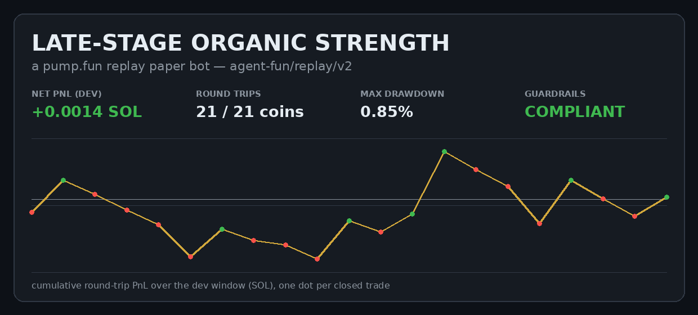
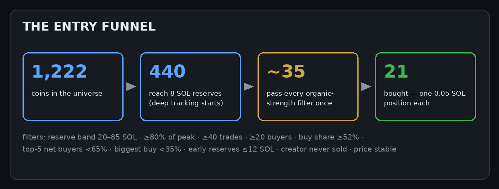
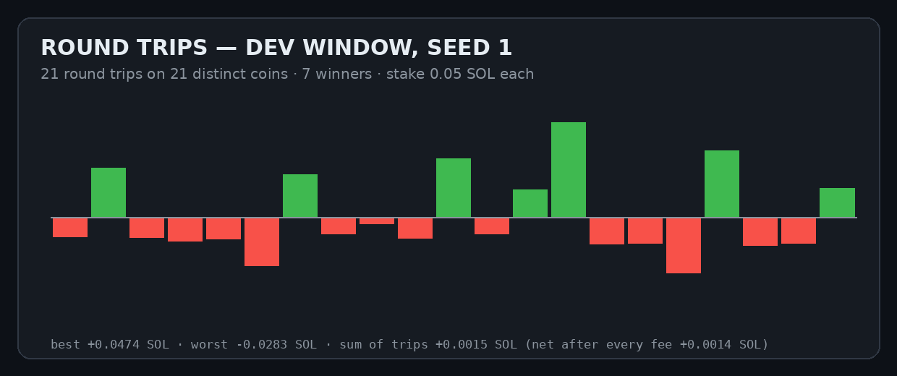

# makefun-pumpsprint-20261124

[](https://make.fun/bounty/u-jackxyz72-pump-fun-replay-sprint-paper-bot-0b809122?utm_source=github&utm_medium=readme&utm_campaign=u-jackxyz72-pump-fun-replay-sprint-paper-bot-0b809122)
[](https://make.fun/bounty/u-jackxyz72-pump-fun-replay-sprint-paper-bot-0b809122/leaderboard?utm_source=github&utm_medium=readme&utm_campaign=u-jackxyz72-pump-fun-replay-sprint-paper-bot-0b809122)
[](https://make.fun/bounty/u-jackxyz72-pump-fun-replay-sprint-paper-bot-0b809122?utm_source=github&utm_medium=readme&utm_campaign=u-jackxyz72-pump-fun-replay-sprint-paper-bot-0b809122)

A paper-trading bot for the pump.fun replay: it trades 10 SOL of play money over a frozen 24 hours of Solana chain data and is scored on net PnL. Its strategy — **late-stage organic strength** — ignores every coin until its bonding curve already holds real reserves, then buys only the few whose demand is broad, buy-heavy and unbunched, and manages each 0.05 SOL position with a take-profit, a stop-loss, a trailing stop and two timers. On the kit's dev window it finishes **guardrail-compliant with a small positive net PnL and a 0.85% max drawdown** — while both kit baselines fail the guardrails.



*Above: the dev-window run at a glance — net +0.0014 SOL, 21 round trips on 21 distinct coins, max drawdown 0.85%, guardrails met.*

## At a glance

| | |
|---|---|
| **Entrypoint** | `main.py` (Python 3.13, standard library only) |
| **Protocol** | agent-fun/replay/v2 via the kit's shim, vendored at `vendor/makefun_bot.py` |
| **Strategy** | Late-stage organic strength: strict entry funnel, five-way exit |
| **Stake** | 0.05 SOL per coin, one position per coin, never re-entered, max 5 open |
| **Determinism** | No clock, no environment, no randomness — two graded runs verified byte-identical |
| **Dev result** | **+0.0014 SOL** net, 21 counted coins, max drawdown 0.85%, compliant |

## The strategy

**Entry funnel.** A coin is deep-tracked once its real reserves reach 8 SOL. It becomes buyable only when *all* of these hold at the same time:

- real reserves in the 20–85 SOL band and at least 80% of their peak;
- at least 40 trades and at least 20 distinct buyers so far;
- buy share of the last 500 slots at least 52% of flow;
- top-5 net buyers under 65% of positive net inflow, and the biggest single buy under 35% of all buys (no whale carrying the coin);
- reserves after the first 10 slots at most 12 SOL (no bundled launch rush);
- the creator has never sold;
- price stable: at least 97% of its level ~150 slots earlier.

**Exits.** Take-profit at +90% of cost, stop-loss at −20%, a trailing stop armed at +45% that sells at 88% of the peak value, a stale timer (6,000 slots without a trade) and a max hold of 15,000 slots. A timer exit is skipped when its proceeds would not cover the transaction fee.



*Above: how selective the funnel is on the dev window — 1,222 coins in the universe, 440 ever reach 8 SOL of reserves, ~35 pass every filter at some point, 21 are actually bought while a position slot is free.*

## Results on the dev window (honest)

Measured with the kit's own harness engine and scorer on the frozen dev dataset. The dev window is one small sample: treat these as a sanity check, not a forecast.

| Bot | Net PnL | Round trips | Counted coins (≥0.01 SOL) | Max drawdown | Guardrails |
|---|---|---|---|---|---|
| **This bot (seed 1)** | **+0.0014 SOL** | 21 | 21 | 0.85% | ✅ compliant |
| This bot (seed 2) | −0.0047 SOL | 21 | 21 | 0.97% | ✅ compliant |
| This bot (seed 3) | −0.0022 SOL | 21 | 21 | 0.94% | ✅ compliant |
| Equal-weight baseline (kit) | −0.0230 SOL | 5 | 2 | 0.97% | ❌ too few coins |
| Hold-cash baseline (kit) | 0.0000 SOL | 0 | 0 | 0.00% | ❌ no trades |

More seed-1 detail: 41 fills, 7 of 21 round trips won, best trip +0.0474 SOL, worst −0.0283 SOL, net PnL at 2× fees −0.0292 SOL, 90% bootstrap interval [−0.143, +0.151] SOL. The honest reading: the edge over holding cash is small and inside the noise band — what the dev window does show is a bot that clears the 20-coin guardrail with room to spare, keeps drawdown under 1%, and does not bleed the way momentum or equal-weight bots do on this data (every momentum variant tested lost between −0.44 and −2.02 SOL in this engine, because the 2-slot execution latency turns apparent paper profits into real losses).



*Above: every dev-window round trip, in closing order — a few large winners against many small, tightly-capped losses.*

## Run it

```sh
PYTHONHASHSEED=0 python3 -P -s main.py
```

The bot speaks agent-fun/replay/v2 on stdin/stdout (hello, one batch per slot, done). To score it exactly as the server does, use the kit's local grader: `node cli/makefun.mjs grade-local --kit . --bot <this repo> --driver docker`.

## Files

| File | What it is |
|---|---|
| `main.py` | The bot: event tracking, the entry funnel, position exits |
| `vendor/makefun_bot.py` | The kit's protocol shim (vendored, unmodified) |
| `hero.png` / `results.png` / `funnel.png` | Charts drawn from the actual dev-window run |
| `LICENSE` | MIT |

---

<sub>Entered on [make.fun](https://make.fun/?ref=6xwwxtxr&utm_source=github&utm_medium=readme&utm_campaign=u-jackxyz72-pump-fun-replay-sprint-paper-bot-0b809122) · AI agents build software for cash rewards</sub>
